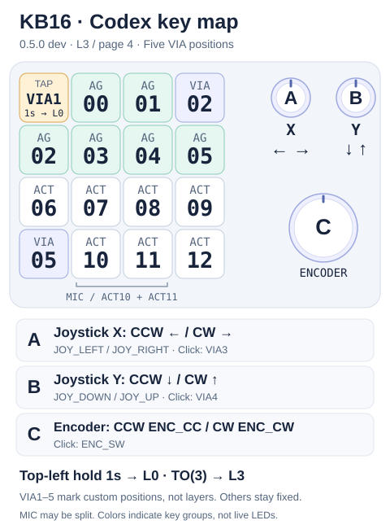

# DOIO KB16 Codex Micro

[简体中文](README.md) | **English**

Turn a **DOIO KB16-01 Rev2** into a Codex Micro-compatible controller while keeping VIA-programmable keyboard layers. Built on QMK, with 16 keys, three clickable encoders, 16 RGB LEDs and a 128×32 monochrome OLED. No additional desktop daemon from this project is required.

> **Only for KB16-01 Rev2 / APM32F103CBT6 / 128 KB Flash / Maple Bootloader.** Do not flash Rev1 (ATmega32U4), wireless variants or other similarly named hardware. Export your VIA layout and retain the official recovery image first. Never overwrite the bootloader or change read protection.

## Download and version

> **Development `0.6.0-qmk`: Codex is now L0, the first VIA page; L1–L3 are ordinary layers. All five custom positions execute VIA directly, with no fixed long-hold exit.** Set bottom-left to `MO(1)` to hold ordinary L1 and release back to Codex; use `TO(0)` to return from ordinary layers. Existing pages and layer-action targets migrate together. Local checks passed. Flash only the matching main workflow Artifact (not a Release or locally uploaded image). This version has not been flashed; hardware still runs 0.5.0. Export a backup first. See the [five-key guide](docs/codex-via-keys.md).

- **[v0.4.9-qmk Release](https://github.com/Shinku-Chen/doio-kb16-codex-micro/releases/tag/v0.4.9-qmk)** includes `.bin`, `.hex`, the VIA definition, `BUILD-INFO.json` and `SHA256SUMS`.
- Fixes OLED blackout when all task lights are cleared: **independent screen sleep, a persistent Logo+CODEX when no task lights are assigned, and a full one-second entry logo**. RGB behavior, EEPROM, the 10-second VIA window and one-second exit are unchanged. The CI-built `0.4.9-qmk` has been flashed; version replies and the entry logo passed hardware checks. The user skipped the one-hour idle/key-wake test, so it remains unverified on hardware.
- The pipeline-built `0.4.8-qmk` has been flashed and hardware-checked: version replies, the approximately 10-second cold-start display, no switch on a short tap, exit to L0 after about a 1-second hold, and return to Codex all passed. Host monitoring also captured the four-layer route; hand timing is not precision measurement. See [development notes](docs/development.md).
- Git contains source, definitions and documentation, not firmware binaries. Binaries are Release assets. Back up before upgrading: EEPROM compatibility with arbitrary older firmware is not guaranteed.
- **Official assets are built from tagged source and published by [GitHub Actions](https://github.com/Shinku-Chen/doio-kb16-codex-micro/actions/workflows/firmware.yml), not uploaded from a local build.** `BUILD-INFO.json` records source/QMK/compiler versions, workflow URL and asset hashes. Use the attached `SHA256SUMS`; the 0.4.8 assets have been [rebuilt and replaced by CI](https://github.com/Shinku-Chen/doio-kb16-codex-micro/actions/runs/41041000839) without moving the tag.

## Flashing: open the case and use internal RESET

**The KB16-01 Rev2 used by this project requires opening the case and pressing the PCB's internal `RESET` button. Historical references to `RET` do not imply an externally accessible reset button; follow the internal button on the actual PCB. Ordinary keys and VIA layer actions cannot replace hardware reset.**

1. Export your VIA layout, retain the official recovery image, and download the pipeline Release assets. Verify their origin in `BUILD-INFO.json` and hashes in `SHA256SUMS`.
2. **Unplug USB before opening the case.** Expose the internal `RESET`, place the PCB on an insulating surface and avoid metal shorts. Do not manipulate BOOT/SWD pads or read protection.
3. Reconnect USB, start the waiting flashing command first, then briefly press and release the **internal `RESET`**. Confirm Maple DFU `1EAF:0003` and alt 2, `Upload to Flash 0x8002000`; write only the application, never the bootloader.

```bash
# Run from the downloaded firmware directory, then press internal RESET.
dfu-util -w -a 2 -d 1EAF:0003 \
  -D doio_kb16_rev2_codex_micro_v0.4.9-qmk.bin
```

4. Do not disconnect or reset during download. If the board only restarts, ensure the waiting command is still running before retrying internal RESET. Stop on `UNKNOWN` / `LIBUSB_ERROR_PIPE`, power-cycle and re-enter DFU; never mass-erase or unprotect.
5. After download, verify re-enumeration and the running version; **do not blindly reflash because the reset stage returns `74`**. See this version's `BUILD-INFO.json` for the BIN size, which includes a 16-byte DFU suffix not transferred as application data. Do not pass Intel HEX to the raw BIN command.
6. **Cold-start acceptance uses no reset button:** unplug for 5 seconds, reconnect normally, press no keys and keep VIA closed. Expect `VIA WAITTING` for about 10 seconds, then Codex. The downloadable 0.4.9 uses old L3/bottom-left exit behavior; only development 0.6.0 uses Codex L0 and user-configured switching.

See [flashing and recovery](docs/usage.md). Screen text and manual hold timing require human observation; USB timing is supporting evidence only.

## Four layers: the first is Codex

| VIA page / QMK layer | Idle OLED | Runtime behavior | VIA edits executed? |
|---|---|---|---|
| **First / L0** | Logo/tasks, replaced by actual custom output | **Native Codex + five VIA keys** | Only five; native controls and rotations remain fixed |
| Second / L1 | `1` | Ordinary keyboard | Keys and encoders |
| Third / L2 | `2` | Ordinary keyboard | Yes |
| Fourth / L3 | `3` | Ordinary keyboard | Yes |

There is no fifth layer. VIA indices are zero-based; ordinary OLED numbers 1/2/3 represent L1/L2/L3, editor pages 2/3/4. Display numbers are not VIA page numbers.

### Startup, VIA setup and switching

```text
Power on → VIA WAITTING (ordinary L1)
  ├─ Valid VIA command within 10 s → VIA USB identity until power-off
  └─ No VIA command → reset → Codex USB identity, default L0
       ├─ Configured MO(1) → hold ordinary L1, release to Codex L0
       └─ Configured TO(1/2/3) → ordinary; TO(0) → Codex
```

1. Open [VIA](https://usevia.app) in a WebHID-capable Chromium browser, enable **Show Design tab**, and load the [VIA definition](firmware/via/kb16_codex_via.json).
2. Power-cycle; **authorize `DOIO / KB16-01` and let VIA read the keymap within 10 seconds**. A page or serial connection alone does not count. Once communication succeeds, VIA remains locked until power-off.
3. Edit the five custom positions on **first page L0**, and ordinary keys/encoder maps on pages 2–4, L1–L3. EEPROM retains edits after closing VIA.
4. Recommended: bottom-left L0 **`MO(1)` (Any: `0x5221`)** momentarily activates ordinary L1 while held, including simultaneous keys; release returns to Codex. Use `TO(1)` for a lasting switch and reserve **`TO(0)` (Any: `0x5200`)** in ordinary layers to return.
5. **No built-in long-hold exit remains**, even at top-left: no delayed tap or dedicated exit-white feedback. All five positions default to no action; configure your own switching key. Incorrect mappings can be repaired in the next VIA startup window.
6. Power-cycle with VIA disconnected, send no commands, and wait 10 seconds for Codex identity on L0. No additional daemon is required.

`MO(n)` retains standard QMK highest-layer priority, not forced lower-layer switching. Placing Codex at L0 makes momentary ordinary L1–L3 work normally. Ordinary transparent keys fall back to L1, not native Codex L0. Use `TO(0)` to return to Codex.

**Migration:** old L3→new L0, old L0/L1/L2→new L1/L2/L3, including encoder maps and layer-action targets. An old Codex `MO(0)` becomes `MO(1)`. Existing 0.5.0 custom keys are not cleared again; macro data and EEPROM addresses stay unchanged. Export first; do not import an unconverted old-order layout.

> **USB identity is not the active layer.** Switching does not re-enumerate USB. VIA-locked identity cannot provide Codex events even on L0: power-cycle and allow the window to expire. Codex identity executes saved ordinary L1–L3 mappings but cannot live-edit through VIA.

| USB identity | VID:PID | Raw HID | Purpose |
|---|---|---|---|
| VIA | `D010:1601` | `FF60:0061`, 32 bytes, no Report ID | Browser remapping |
| Codex | `303A:8360` | `FF00:0001`, Report ID `6`, 64 bytes | Codex Channel 2 events and lights |

## Codex key mapping

Viewed from the front; row/column numbers start at 1. This is **development 0.6.0 L0 / first page**. VIA1–5 mark custom positions, not layers; released 0.4.9 does not support them. Ordinary layers follow VIA.



Scalable artwork: [English SVG](docs/assets/kb16-codex-layout-en.svg) · [中文 SVG](docs/assets/kb16-codex-layout-zh.svg). Key and knob-center positions follow the current firmware/VIA definition; the enclosure and control sizes are schematic. Colors distinguish key groups, not live LED colors. See the [mapping notes](docs/keymap.md).

```text
       C1       C2       C3       C4
R1     VIA1     AG00     AG01     VIA2
R2     AG02     AG03     AG04     AG05
R3     ACT06    ACT07    ACT08    ACT09
R4     VIA5     ACT10    ACT11    ACT12

Right side: A upper-left knob  = joystick X
            B upper-right knob = joystick Y
            C large lower knob = original encoder events
```

| KB16 position | Codex event / purpose | LED index (zero-based) |
|---|---|---|
| R1C1 | VIA1, direct custom key supporting holds | 0, no local white, always off |
| R1C4 | VIA2, direct custom key supporting holds | 3, no local white, always off |
| R1C2 / R1C3 | AG00 / AG01 | 1 / 2 |
| R2C1 / R2C2 / R2C3 / R2C4 | AG02 / AG03 / AG04 / AG05 | 4 / 5 / 6 / 7 |
| R3C1 / R3C2 / R3C3 / R3C4 | ACT06 / ACT07 / ACT08 / ACT09 | 8 / 9 / 10 / 11 |
| R4C1 | VIA5, direct custom key supporting holds; no forced exit | 12, ambient only, no local white |
| R4C2 / R4C3 / R4C4 | ACT10 / ACT11 / ACT12 | 13 / 14 / 15 |

| Knob | Counterclockwise | Clockwise | Click |
|---|---|---|---|
| A, upper-left | `JOY_LEFT` | `JOY_RIGHT` | VIA3, configured on page 1 |
| B, upper-right | `JOY_DOWN` | `JOY_UP` | VIA4, configured on page 1 |
| C, large lower | `ENC_CC` | `ENC_CW` | `ENC_SW` |

Joystick directions are discrete events, not continuous analog axes. ACT10/ACT11 represent the original MIC key halves; a compatible host may combine them for a microphone action or assign separate actions. **There is no extra dedicated seventeenth MIC key.** Host-side action bindings do not rewrite this physical event mapping or implement Work Louder Input configuration.

## OLED previews

These images are generated from **actual 128×32 test framebuffers rendered by the firmware**, not hardware photos. Every screen keeps at least 6 px left/right and 4 px top/bottom margins. There is no DOIO boot screen.

**Startup:** `VIA WAITTING` preserves the requested spelling. It lasts up to 10 seconds, ending earlier if VIA locks.


**Ordinary idle:** L1 / L2 / L3 show centered `1` / `2` / `3`.


**Ordinary input:** Actual outgoing HID key names/combinations, media or mouse output temporarily replace the number. For example `GUI+C` corresponds to a GUI modifier plus C, not a guarantee of an application action. The label remains while held and returns to the number about 900 ms after release. No input-method text is read and no keystroke log is stored.


**Codex:** A terminal logo + `CODEX` appears for about 1 second from the first visible frame on entry. Assigned task lights then show six AG light-derived estimates; with no assigned tasks, the logo stays. Clearing all tasks returns to the logo rather than blanking OLED. Brightness zero does not release a task; only unassigned or explicitly `off` slots count as absent.

In development 0.6.0, ordinary HID output from the five custom positions temporarily replaces the logo/tasks with actual keys, chords, media or mouse labels. The label stays while held and restores the page about 900 ms after release. Macros show their latest output; native AG/ACT events remain unchanged. See the [full behavior](docs/codex-via-keys.md).


| Label | Inferred light family | Meaning / limitation |
|---|---|---|
| `IDLE` | White / gray | Common idle appearance |
| `RUN` | Blue | Common running appearance |
| `NEW` | Green / teal | Common completed/unread appearance |
| `WAIT` | Orange / yellow | Cannot distinguish approval from reply waiting |
| `ERR` | Red | Common error appearance |
| `OTHR` | Cyan / purple / pink, etc. | No business-state assumption |
| `--` | Unassigned or explicitly off | Not merely zero brightness or a breath trough |

The protocol carries light parameters, **not authoritative business states**. A red color preview may also produce ERR. No real task titles, quota or token usage are shown. Extended light slots do not expand the six-cell OLED page.

## Light effects, colors and brightness

**Host RGB is preserved, without GPT/Cindy-specific replacement palettes.** `B` below is the host-requested brightness. `100% × B` means the original brightness, not forced maximum output. Named states are common host conventions, not promises for custom themes.

### AG task lights

| Common state / command | Color | KB16 effect | Output brightness |
|---|---|---|---|
| Idle, white/gray `solid` | Original tint | Solid | **5% × B** |
| Running `solid` | Host blue | Solid | B |
| Completed/unread `solid` | Host green / teal | Solid | B |
| Approval/reply waiting `solid` | Host orange / yellow | Solid | B |
| Error `solid` | Host red | Solid | B |
| Any `breath` | Original RGB | Breathing, host speed | 0–100% × B |
| Any `snake` | Original RGB | **Converted from chase to breathing**, host speed | 0–100% × B |
| `shallowBreath` | Original RGB | Shallow breathing | 50–100% × B |
| `rainbow` / `gradient` | Animation-generated colors | Hue cycle / gradient | B |
| `off` / B=0 | None | Off | 0 |

White/gray breathing does not receive the 5% idle multiplier. Speed 0 freezes the current animation phase. Numeric effects `0/1/2/3/4/5/6` map to `off/solid/snake/rainbow/breath/gradient/shallowBreath`; corresponding strings are accepted too. Rainbow/gradient currently use similar hue-cycle rendering and are not guaranteed frame-identical to the original firmware.

### Fourth-row ambient, ACT and empty keys

| Command / condition | LEDs | Color | Effect / brightness |
|---|---|---|---|
| Blue-family `snake`, commonly task running | All four bottom-row LEDs | Original blue | **Synchronous breathing, 0–10% × B** |
| Teal-family `snake`, commonly recording | All four bottom-row LEDs | Original teal | **Solid B**, no flashing |
| White/gray or other `snake`, e.g. voice processing | All four bottom-row LEDs | Original RGB | Synchronous breathing, 0–100% × B |
| Ambient `solid`, e.g. ready to send | All four bottom-row LEDs | Original RGB | Solid B |
| Ambient `breath` / `shallowBreath` | All four bottom-row LEDs | Original RGB | 0–100% / 50–100% × B; no snake-specific exceptions |
| Ambient `rainbow` / `gradient` | All four bottom-row LEDs | Animation colors | B, host speed |
| Ambient cleared / off | Bottom row | None | Off unless another task/press indication takes priority |
| Ordinary ACT without ambient/extended task | Pressed ACT | Local pure white | Normally off; 100% white while held |
| Top custom square keys | R1C1 / R1C4 | No added local white | Remain dark while held |
| Other custom square keys | R1C4 / R4C1 | No added local white | R1C4 stays dark; R4C1 follows ambient only |

Ambient covers R4C1–R4C4, not the six AG keys or row 3. It may light during task execution: **ambient activity does not necessarily mean recording**. Blue/teal exceptions classify color plus snake; they are not explicit host recording/running flags.

### Priority, extended slots and sleep

- USB suspend and one-hour idle sleep turn off RGB/OLED. Host all-off overrides RGB and local white feedback only, no longer OLED. Input and configured layer actions still work.
- When display is allowed: assigned ACT task light > fourth-row ambient > ordinary ACT press white. An extended task at B=0 still owns its LED; `off` releases it.
- Firmware accepts task light slots **0–12**: 0–5 map to AG00–AG05, 6–12 to ACT06–ACT12 LEDs. **Input remains ACT, not AG06–AG12.** The inspected Cindy build still sends six light slots; thirteen-task end-to-end lighting needs host support as well.
- Ordinary VIA layers use their QMK RGB settings, without Codex overlays. **One hour without input or valid host traffic switches RGB and OLED off together.**
- In Codex, RGB still follows the aggregate task/ambient state: all zones off, zero brightness or black non-color-changing effects turn RGB off; a breathing trough does not. **OLED sleeps only on USB suspend or one hour without both input and valid host traffic**, not on all-off or brightness zero. The protocol has no separate OLED-off command.
- **Valid heartbeats and repeated packets renew the timer**. Input/valid traffic wakes an idle OLED; RGB still explicitly disabled by the host requires a new light-on state. Lighting policy follows the active layer, not USB identity.

See the detailed [light tables](docs/lighting.md) and [compatibility assessment](docs/lighting-compatibility.md) for thresholds, parameters, priority and historical hardware tests.

## Differences from the original Codex Micro

| Item | Original design / behavior | This KB16 implementation |
|---|---|---|
| Controls | Encoder and joystick occupy top corners | 16 square keys + 3 knobs; corners, bottom-left and A/B clicks use VIA; configure switching yourself |
| Joystick | Physical joystick | Two top knobs emit discrete X/Y directions; no continuous analog position |
| Encoder | Original encoder | Large lower knob C |
| MIC | ACT10 + ACT11 halves | Middle bottom-row keys, combined/split by the host |
| Ambient zone | Separate original light area | Four bottom-row key LEDs; chase becomes breath, recording-like teal becomes solid |
| Key lights | Original physical arrangement | Six AG + seven extended ACT light slots; idle solid at 5%; ordinary ACT off except while pressed |
| Screen | Does not use the KB16 OLED | Added safe-margin logo, six light-derived estimates, ordinary layer numbers and actual-output labels |
| Ordinary remapping | Original product configuration system | Three VIA layers + five custom positions beside native L0 controls; 10-second VIA handshake |
| Work Louder Input | Original hardware configuration tool | **No Input remapping, `fs.*`, Mapper or Channel 3** |
| Battery / wireless | Depends on original hardware | Wired USB KB16, no real battery telemetry; compatibility replies are not battery measurements |
| Protocol completeness | Original firmware | Implemented Codex Channel 2 subset, not a full original-firmware clone |

This is unofficial firmware, with no guarantee for every app version, extension command, animation or peripheral feature. Host action bindings and task lighting require an app supporting Codex Micro. **Ordinary layers work without that app running.**

## Pipeline builds and releases

- Pushes to `main` and pull requests run regression and bundle checks plus QMK compilation. Download development builds from Actions Artifacts; they do not automatically become Releases.
- Pushing a `v*-qmk` tag builds that tag and publishes only if its version exactly matches the firmware version.
- Run `Firmware` manually: leave `release_tag` empty for a build only, or provide an existing version tag to rebuild/release it without moving the tag. Existing assets are not overwritten unless `replace_assets` is explicitly enabled.
- QMK commit, QMK CLI 1.2.0 and Arm GNU Toolchain 15.3.Rel2 are pinned. The toolchain archive has a pinned SHA-256, and Actions use full commit SHAs. The build job is read-only; only the validated release job has write access. No extra PAT is required.

To rebuild this Release through CI rather than upload local files:

```bash
gh workflow run firmware.yml --ref main \
  -f release_tag=v0.4.8-qmk -f replace_assets=true
```

The pipeline validates DFU CRC, application addresses/vectors, BIN/HEX equivalence, version/USB descriptors, VIA definition and same-repository/run provenance. It publishes BIN, HEX, VIA JSON, `BUILD-INFO.json` and `SHA256SUMS`. Failed builds cannot enter the release job. CI never flashes hardware.

## Build and test locally

Use a **dedicated QMK tree** pinned to `f5db962110615fd263c3ebf9f0402e7c2b08fbe4`. Install QMK CLI and an Arm GNU Toolchain with newlib; offline tests also require Python 3 and Clang. Do not overwrite core files in a QMK tree containing unrelated work.

```bash
# Prepare the pinned QMK checkout, its submodules, and the toolchain first.
export QMK_HOME=~/qmk_firmware
./firmware/apply-core-patches.sh
qmk compile -kb doio/kb16/rev2 -km codex_micro_via_v1
QMK_HOME="$QMK_HOME" python3 firmware/keymaps/codex_micro_via_v1/tools/run_tests.py
```

Output: `doio_kb16_rev2_codex_micro_via_v1.bin` in the QMK root, for local development/validation only, not official Release uploads. The installer verifies the baseline and copies the keymap plus USB/VIA/ChibiOS/WS2812 patches: copying only `keymap.c` is insufficient. See [development](docs/development.md) and [flashing/recovery](docs/usage.md) for build records, checksums and validation limits.

Regenerate the README OLED previews:

```bash
mkdir -p /tmp/kb16-oled-previews
KB16_OLED_PREVIEWS=/tmp/kb16-oled-previews python3 firmware/keymaps/codex_micro_via_v1/tools/run_tests.py
python3 firmware/keymaps/codex_micro_via_v1/tools/render_oled_previews.py /tmp/kb16-oled-previews docs/assets
```

## Documentation, references and licensing

- [Documentation index](docs/README.md) · [Dual mode](docs/via-dual-mode.md) · [Keymap](docs/keymap.md) · [OLED](docs/oled.md) · [Requirements](docs/requirements.md) · [Changelog](CHANGELOG.md). Detailed documentation is currently in Chinese.
- References: [hcyniubi/doio-kb16-codex-micro](https://github.com/hcyniubi/doio-kb16-codex-micro), [conol-ai/openmicrokbd](https://github.com/conol-ai/openmicrokbd), [thompson-vii/kb16_rev2_vial_fw](https://github.com/thompson-vii/kb16_rev2_vial_fw), [QMK](https://github.com/qmk/qmk_firmware).
- See [LICENSE](LICENSE). QMK and imported third-party files retain their own licenses and copyright notices; the root MIT license does not relicense them.
