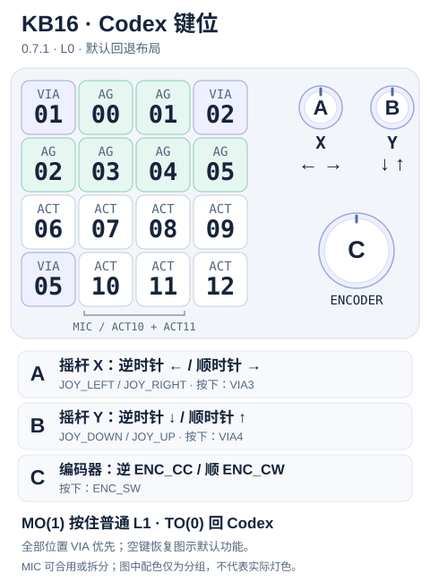

# DOIO KB16 Codex Micro 兼容固件

**简体中文** | [English](README.en.md)

把 **DOIO KB16-01 Rev2** 变成 Codex Micro 兼容控制器，同时保留 VIA 普通键盘层。基于 QMK，支持 16 键、三个可按旋钮、16 颗 RGB 灯和 128×32 单色 OLED；不需要额外运行本项目的电脑端程序。

> **仅适用于 KB16-01 Rev2 / APM32F103CBT6 / 128 KB Flash / Maple Bootloader。** 不适用于 Rev1（ATmega32U4）、无线版或其他同名硬件。刷写前导出 VIA 配置并保留官方回退镜像；不要擦写 Bootloader 或更改读保护。

## 固件下载与当前版本

> **当前版本 `0.7.2-qmk`：Codex L0 全部按键、旋钮按下和旋转均为 VIA 优先；`KC_NO` / `KC_TRNS` 恢复该位置原生 Codex 功能。** 提供三层普通 VIA 键盘、任务灯、OLED 输出提示。Codex L0 的 16 个方键逐键按住白光；Codex RGB/OLED 不再因一小时空闲关闭，仅普通 VIA L1–L3 保留。详见 [Codex / VIA 混合层](docs/codex-via-keys.md)。

> **0.7.2 EEPROM 兼容修复（升级前必读）**：0.7.2 修复跨编译日期刷机导致 VIA 配置被恢复默认的问题。VIA 只接受固定 `KB` + schema 1 三字节 marker，只校验格式标记，不是 payload CRC，不保证检测配置内容任意损坏。**从 0.7.1/更旧固件首次升级会恢复一次 VIA 默认（键位/encoder/宏/布局选项）并写新 marker；请先导出 VIA 配置并保留回退镜像。** 之后同 schema 跨编译日期/固件版本保留这些配置；旧日期 marker、旧 schema、空白/未知 EEPROM 都恢复 VIA 默认，不迁移旧页序/自定义位置，也不额外重置 RGB 等 QMK 全局设置（QMK 自身全局标记失效时仍按原逻辑初始化）。存储地址和 `VIA_EEPROM_ALLOW_RESET` 远程清空权限均不变（后者仍未启用）。

> **验收状态**：2026-11-04 用户已确认按压白光功能，基于 `db2cdf1` 同逻辑流水线开发镜像（版本字符串仍为 `0.7.0-qmk`）。正式 `0.7.2-qmk` 已刷入，并通过 USB/RPC 确认运行在 Codex L0；配置跨日期保留、实机 EEPROM 掉电中断及 Flash 读回尚未验证。普通 VIA 层灯光、真实长时间空闲和光度测量仍未验收。见 [刷写记录](docs/development.md)。

切层动作由 VIA 自行配置：`MO(1)` 按住进入普通 L1、松开返回，`TT(1)` 兼顾按住与连续点按锁层，`TO(0)` 返回 Codex。具体行为见下方切层说明。

- **[v0.7.2-qmk Release](https://github.com/Shinku-Chen/doio-kb16-codex-micro/releases/tag/v0.7.2-qmk)**：固件 `.bin` / `.hex`、VIA 定义、`BUILD-INFO.json` 和 `SHA256SUMS`，正式附件仅由该标签的 GitHub Actions 生成。
- Git 仓库只保存源码、定义和文档；编译产物只放 Release。升级前导出 VIA 配置并检查 L0 按键及旋钮映射；已保存的普通映射会覆盖该位置的 Codex 功能。导入备份前检查页序和层动作目标。
- **正式固件由 [GitHub Actions](https://github.com/Shinku-Chen/doio-kb16-codex-micro/actions/workflows/firmware.yml) 从标签源码生成和发布，不使用本机编译附件。** `BUILD-INFO.json` 记录源码提交、QMK/编译器版本、流水线链接及资产摘要，最终校验和见 `SHA256SUMS`。
- `0.7.2-qmk` 保留 0.7.1 的逐键白光优先和 Codex 无空闲超时，并加入上述 EEPROM 兼容修复；相对已验证的 EEPROM 修复源码，本次发布准备只改版本 metadata/文档，不改变运行逻辑。正式 `0.7.2-qmk` 已刷入，并通过 USB/RPC 确认运行在 Codex L0；普通层灯光/一小时休眠、Codex 长时间保持及 Flash 读回仍有验收边界，详见 [开发与验证](docs/development.md)。

## 刷机：拆机按内部 RESET

**本项目这台 KB16-01 Rev2 需要拆开外壳，按 PCB 内部的 `RESET` 按键进入刷写流程。普通键和 VIA 切层不能代替硬件复位。**

1. 先导出 VIA 配置，准备官方回退镜像，下载流水线 Release 的全部附件（BIN/HEX、VIA 定义、`BUILD-INFO.json`、`SHA256SUMS`）并核对来源/哈希。
2. **断开 USB 后再拆外壳**，露出 PCB 内部 `RESET`。将板子放在绝缘表面，避免金属工具短接；不要操作 BOOT/SWD 焊盘或改读保护。
3. 接回 USB，在电脑先启动刷写等待，然后**短按内部 `RESET` 并松开**，捕获 Maple DFU `1EAF:0003`。目标必须是 alt 2 的 `Upload to Flash 0x8002000`；只写应用区，不写 Bootloader。

```bash
# 在固件文件所在目录执行；命令先等待设备，再按内部 RESET
dfu-util -w -a 2 -d 1EAF:0003 \
  -D doio_kb16_rev2_codex_micro_v0.7.2-qmk.bin
```

4. 下载期间不要拔线或再按复位。若只重启、没捕获 DFU，先确认等待命令仍在，再重新尝试内部 RESET；出现 `UNKNOWN` / `LIBUSB_ERROR_PIPE` 则停止，断电重新进入，不做全片擦除或解保护。
5. 下载完成后核验重新枚举及版本，**不要仅因复位阶段返回 `74` 就重复刷写**。BIN 大小以本版 `BUILD-INFO.json` 为准，其中包含 16 字节 DFU suffix，下载主体不含 suffix。HEX 不是原始 BIN，不能传给上述命令。
6. **验证正常开机时不按任何复位键**：拔 USB 等 5 秒，正常插回，不按内部 RESET 或其他键，不开 VIA。应显示 `VIA WAITTING` 约 10 秒，随后进入 Codex L0。层切换由 VIA 配置，没有固定长按退出。

首次刷写与回退的完整步骤、识别失败处理见 [使用与刷写](docs/usage.md)。屏幕文字和手按时长需要实机目视确认，USB 枚举计时只是辅助证据。

## 四层：第一层就是 Codex

| VIA 编辑页 / QMK 层 | OLED 空闲显示 | 实际用途 | VIA 改键是否执行 |
|---|---|---|---|
| **第 1 页 / L0** | Logo/任务页，自定义输出临时替换 | **Codex 默认功能 + VIA 优先覆盖** | 全部按键/按压/旋转；空键恢复默认 |
| 第 2 页 / L1 | `1` | 普通键盘 | 按键和旋钮均可配置 |
| 第 3 页 / L2 | `2` | 普通键盘 | 是 |
| 第 4 页 / L3 | `3` | 普通键盘 | 是 |

共四层，VIA 索引从零开始；第一页就是 L0。屏幕给三个普通层编号 1/2/3，对应 L1/L2/L3，即 VIA 第 2/3/4 页；不是 VIA 的页号。

### 启动、改键与切层

```text
真正断电后插入 USB → VIA WAITTING（普通 L1）
  ├─ 10 秒内收到有效 VIA 命令 → VIA 身份锁定，直到断电
  └─ 10 秒内没有 VIA 命令 → 自动复位 → Codex 身份，默认 L0
       ├─ 自配 MO(1) → 按住使用普通 L1，松开回 Codex L0
       └─ 自配 TO(1/2/3) → 普通层；TO(0) → Codex
```

**开机 10 秒内用 VIA 改键：**

1. 提前在支持 WebHID 的 Chromium 浏览器打开 [VIA](https://usevia.app)，启用 **Show Design tab**，载入 [VIA 定义](firmware/via/kb16_codex_via.json)。
2. 键盘断电重插，看到 `VIA WAITTING` 后，**10 秒内授权 `DOIO / KB16-01` 并让 VIA 成功读取键位**。只打开网页或串口不算命令；成功后一直锁定，不必十秒内改完。
3. 第一页 L0 可修改任意按键、三个旋钮按下及各旋转方向，VIA 非空配置优先执行；`KC_NO` / `KC_TRNS` 恢复对应默认功能（无原生功能的位置仍无动作）。普通整层在第二至第四页 L1–L3 修改，配置保存在 EEPROM。
4. 推荐第一页左下角设 **`MO(1)`（Any：`0x5221`）**，按住进入普通 L1，可同时按该层其他键，松开回 Codex。也可用 `TO(1)` 常驻普通层；给普通层预留 **`TO(0)`（Any：`0x5200`）** 返回 Codex。
5. **请自行保留切层入口**：固件不设固定退出键或退出长按；R1C1、R1C4、R4C1 及顶部两个旋钮按下默认无动作，可配置为切层键。配置错误可重新在开机 VIA 窗口修正。
6. 改完后断电重插，关闭 VIA，不发送命令；等待十秒，Codex USB 身份默认进入 L0。不需要额外程序。

`MO(n)` 保留 QMK 标准的“高层优先”规则，不是强制切到任意低层；Codex 放在最低 L0 后，向普通 L1–L3 临时切层可自然生效。普通层的透明键继承普通基底 L1，不会漏出 L0 的 AG/ACT；要回 Codex 用 `TO(0)`。

**常用切层动作：**

| VIA 键码 | 行为 |
|---|---|
| `MO(1)` | 按下立即启用普通 L1，松开返回 |
| `TT(1)` | 按住临时启用 L1；默认快速点按 5 次锁定或解除 L1。需要点按/长按判定，当前默认窗口为 200 ms |
| `TO(1)` / `TO(2)` / `TO(3)` | 常驻对应普通层 |
| `TO(0)` | 返回 Codex L0 |

`TT(1)` 按住时短暂等待属于其判定逻辑；只需按住切层可选 `MO(1)`。这些动作均可在 VIA 中配置，无需重新编译固件。

> **USB 身份不等于键盘层。** 切层不重新枚举 USB；VIA 锁定时切到 L0 也没有可用 Codex 专用接口。须断电重插，让十秒窗口超时。Codex 身份下 L1–L3 使用已保存的 VIA 配置，但不能当场在线改键。

| USB 身份 | VID:PID | Raw HID | 用途 |
|---|---|---|---|
| VIA | `D010:1601` | `FF60:0061`，32 字节，无 Report ID | 浏览器改键 |
| Codex | `303A:8360` | `FF00:0001`，Report ID `6`，64 字节 | Codex Channel 2 事件与灯光 |

## Codex 键位对应表

面向键盘，R/C 从 1 开始；下图描述 **L0 / 第一页的默认回退功能**，所有按键/旋钮均可由 VIA 覆盖。VIA1–5 标识五个无原生功能的自定义位置，不是层号，也不限制可编辑位置。



矢量图可放大查看：[中文 SVG](docs/assets/kb16-codex-layout-zh.svg) · [English SVG](docs/assets/kb16-codex-layout-en.svg)。键位与旋钮中心位置按当前固件/VIA 定义绘制，外观非等比例；图中配色只区分按键类型，不代表实际灯色。完整说明见 [键位图](docs/keymap.md)。

```text
       C1       C2       C3       C4
R1     VIA1     AG00     AG01     VIA2
R2     AG02     AG03     AG04     AG05
R3     ACT06    ACT07    ACT08    ACT09
R4     VIA5     ACT10    ACT11    ACT12

右侧：A 左上旋钮 = 摇杆 X；B 右上旋钮 = 摇杆 Y
      C 下方大旋钮 = 原厂编码器
```

| KB16 位置 | Codex 事件 / 用途 | LED（从 0 开始） |
|---|---|---|
| R1C1 | VIA1，直接自定义，支持按住 | 0，按住白光，松开灭 |
| R1C4 | VIA2，自定义普通键，可按住 | 3，按住白光，松开灭 |
| R1C2 / R1C3 | AG00 / AG01 | 1 / 2 |
| R2C1 / R2C2 / R2C3 / R2C4 | AG02 / AG03 / AG04 / AG05 | 4 / 5 / 6 / 7 |
| R3C1 / R3C2 / R3C3 / R3C4 | ACT06 / ACT07 / ACT08 / ACT09 | 8 / 9 / 10 / 11 |
| R4C1 | VIA5，自定义普通键，支持按住 | 12，按住白光，松开恢复环境灯或熄灭 |
| R4C2 / R4C3 / R4C4 | ACT10 / ACT11 / ACT12 | 13 / 14 / 15 |

| 旋钮 | 逆时针 | 顺时针 | 按下 |
|---|---|---|---|
| A（左上） | `JOY_LEFT`，摇杆左 | `JOY_RIGHT`，摇杆右 | VIA3，第一页自定义 |
| B（右上） | `JOY_DOWN`，摇杆下 | `JOY_UP`，摇杆上 | VIA4，第一页自定义 |
| C（下方大旋钮） | `ENC_CC` | `ENC_CW` | `ENC_SW` |

摇杆是离散方向事件模拟，不是连续二维模拟轴。ACT10/ACT11 对应原厂 MIC 的两个半键，可以在支持的宿主里合用为麦克风，也可拆分为其他动作；**没有独立的第 17 个 MIC 键**。宿主内修改 AG/ACT 的功能绑定，不会改写这张固件物理事件表，也不等于 Work Louder Input 配置。

## 小屏幕展示

以下由**当前固件测试实际输出的 128×32 帧缓冲**生成，不是实机照片。所有画面保留左右至少 6 px、上下至少 4 px 安全边距，不显示 DOIO 开机页。

**上电等待：** `VIA WAITTING`（保留指定拼写），最多 10 秒；VIA 锁定后提前结束等待页。


**普通层空闲：** L1 / L2 / L3 分别居中显示 `1` / `2` / `3`。


**普通层按键时：** 临时替换层号，显示实际发出的 HID 键名/组合（如 `GUI+C`）、媒体或鼠标输出；按住保留，松开约 900 ms 回层号。显示的不是输入法文字或应用最终动作，不保存按键日志。


**进入 Codex：** 从首个可显示帧起展示终端 Logo + `CODEX` 约 1 秒；有任务灯分配时随后显示六个 AG 灯的状态估计，无任务灯分配时持续显示 Logo。任务结束并清除全部任务灯后回到 Logo，RGB 全灭不会关闭 OLED。亮度 0 不等于任务释放，只有未分配或明确 `off` 才算无任务。

任意位置的 VIA 覆盖发出普通 HID 时，实际键名/组合/媒体/鼠标输出临时覆盖 Logo/任务页，按住保留、松开约 900 ms 恢复；宏显示最近输出。原生 AG/ACT 不产生普通键提示。见 [完整规则](docs/codex-via-keys.md)。


| OLED 标签 | 灯色推断 | 注意 |
|---|---|---|
| `IDLE` | 白 / 灰 | 空闲外观约定 |
| `RUN` | 蓝 | 常见运行提示 |
| `NEW` | 绿 / 海绿 | 常见完成未读提示 |
| `WAIT` | 橙 / 黄 | 等待审批或回复，不能区分二者 |
| `ERR` | 红 | 常见错误提示 |
| `OTHR` | 青 / 紫 / 粉等 | 不猜测业务含义 |
| `--` | 未分配或明确 off | 不只是呼吸最低点或亮度为 0 |

协议提供灯光参数，**并不提供可靠的任务业务状态**。上述标签只是通用色类推断：例如红色预览也可能显示 ERR。OLED 不显示真实任务标题、额度或 token；扩展灯槽也不会增加当前六格任务页。

## 灯效、颜色与亮度

**宿主下发原色，不设置 GPT/Cindy 专属色表。** 下表 `B` 为宿主指定的亮度；`100% × B` 就是原亮度，不是强制满亮。颜色代表常见宿主约定，不保证自定义主题有相同含义。

### AG 任务灯

| 常见状态 / 下发 | 颜色 | KB16 样式 | 输出亮度 |
|---|---|---|---|
| Idle，白/灰 `solid` | 保留宿主白/灰色调 | 常亮 | **5% × B** |
| 运行 `solid` | 宿主蓝色 | 常亮 | B |
| 完成未读 `solid` | 宿主绿 / 海绿 | 常亮 | B |
| 等待审批 / 回复 `solid` | 宿主橙 / 黄 | 常亮 | B |
| 错误 `solid` | 宿主红色 | 常亮 | B |
| 任意状态 `breath` | 宿主原色 | 呼吸，跟随速度 | 0–100% × B |
| 任意状态 `snake` | 宿主原色 | **跑马映射为呼吸**，跟随速度 | 0–100% × B |
| `shallowBreath` | 宿主原色 | 浅呼吸 | 50–100% × B |
| `rainbow` / `gradient` | 动画生成变化色 | 色相循环 / 渐变 | B |
| `off` / B=0 | 无光 | 熄灭 | 0 |

白/灰呼吸不叠加 Idle 的 5% 系数。速度 0 暂停动画当前相位。数字效果 `0/1/2/3/4/5/6` 依次为 `off/solid/snake/rainbow/breath/gradient/shallowBreath`，也接收对应字符串；当前 rainbow/gradient 使用同类色相循环实现，不承诺原厂逐帧动画一致。

### 第四排环境灯、ACT 和空位

| 场景 / 下发 | 灯位 | 颜色 | 样式 / 亮度 |
|---|---|---|---|
| 蓝色系 `snake`，通常为当前任务运行 | 第四排全部四灯 | 保留蓝色 | **同步呼吸 0–10% × B** |
| 海绿色系 `snake`，通常为录音 | 第四排全部四灯 | 保留海绿 | **常亮 B**，不闪烁 |
| 白/灰或其他颜色 `snake`，如语音处理 | 第四排全部四灯 | 保留原色 | 同步呼吸 0–100% × B |
| 环境 `solid`，如待发送 | 第四排全部四灯 | 保留原色 | 常亮 B |
| 环境 `breath` / `shallowBreath` | 第四排全部四灯 | 保留原色 | 0–100% / 50–100% × B，不套 snake 例外 |
| 环境 `rainbow` / `gradient` | 第四排全部四灯 | 动画变化色 | B，跟随速度 |
| 环境清除 / off | 第四排 | 无光 | 熄灭；若有任务灯或按住反馈则按其优先级显示 |
| 任意方键按住，含 AG、ACT、空键及 VIA 覆盖键 | 对应物理 LED | 本地纯白 | 100% 白光，覆盖任务、环境和宿主关灯；松开恢复最新灯态 |
| 旋钮按下 | 无独立按键 LED | 无 | 不借用其他方键的灯 |

环境灯覆盖 R4C1–R4C4，不覆盖六 AG 或第三排。任务运行时环境灯也可能亮，**亮灯不等于正在录音**；蓝/海绿规则基于色类与 snake，不是宿主单独传了“运行/录音”状态。

### 优先级、扩展灯和息屏

- Codex L0 的 16 个方键按住时均亮 100% 纯白，与 AG/ACT 身份、VIA 键码及宿主是否连接无关；按住多键时分别亮白，不修改宿主灯态。
- 软件灯效优先级：**物理按住白光 > 全局背景关灯 > 任务灯 > 第四排环境 > 熄灭**。USB 挂起时所有灯仍关闭；松开后按最新宿主状态恢复。任务 B=0 仍占有背景灯位，`off` 才释放，但都不能盖住按住白光。
- 固件支持任务灯槽 **0–12**：0–5 对应 AG00–AG05，6–12 对应 ACT06–ACT12 的 LED；**输入仍是 ACT，不会变成 AG06–AG12**。十三任务端到端灯光需要宿主发送全部十三槽；只发送六槽的宿主只使用六个 AG 任务灯。
- VIA 普通层按自己的 QMK RGB 配置运行，无 Codex 任务/环境覆盖；**一小时无输入或有效通信，背光与 OLED 同时关闭**。
- **Codex L0 没有一小时空闲关闭**：即使长时间无输入、心跳或灯态更新，RGB 仍保持宿主最后下发状态；全部 off、零亮度或非变色效果全黑时关闭背景，呼吸最低点不算关灯。OLED 保留 Logo/任务页，**仅在 USB 挂起时关闭**，不跟随任务灯全灭或亮度 0；协议没有单独的 OLED 关屏指令。
- 普通 VIA 层的**有效心跳与重复报文都会续时**，输入或有效通信可唤醒空闲关闭的 RGB/OLED。Codex 背景若仍被宿主明确关闭，则须重新下发点亮状态，按住白光不受此限制。灯光策略取决于当前层，不取决于 USB 身份。

完整分类阈值、参数兼容与优先级：[灯光表](docs/lighting.md) · [实现边界](docs/lighting-compatibility.md)。

## 与原版 Codex Micro 的差异

| 项目 | 原版形态 / 行为 | 本项目 KB16 |
|---|---|---|
| 硬件 | 编码器 + 摇杆占据顶角，其他位置是功能键 | 16 方键 + 3 旋钮；全部按键、按压与旋转均可用 VIA，自配层切换 |
| 摇杆 | 实体摇杆 | 两个顶部旋钮模拟 X/Y 方向事件，无连续模拟位置 |
| 编码器 | 原厂编码器 | 下方大旋钮 C |
| MIC | ACT10 + ACT11 两半键 | 第四排中间两键，可由宿主合用/拆分 |
| 灯带 / 环境光 | 原厂独立环境灯区域 | 映射第四排四颗键灯；snake 变呼吸，海绿录音外观常亮 |
| 按键灯 | 原厂物理布局对应宿主灯态 | 六 AG + 七 ACT 扩展槽；Idle 常亮 5%，全部 16 个方键按住白光优先 |
| 屏幕 | 不依赖 KB16 的 OLED | 增加留边 Logo、六灯状态估计、普通层号及实际输出提示 |
| 普通键盘 / 改键 | 原厂产品自身配置体系 | 普通 L1–L3；L0 全部 VIA 优先、空键回退 Codex；10 秒 VIA 身份协商 |
| Work Louder Input | 原厂支持的硬件配置工具 | **不实现 Input 改键、`fs.*`、Mapper / Channel 3** |
| 电量 / 无线 | 取决于原厂设备 | KB16 为 USB 有线，无真实电池遥测；协议兼容应答不等于有电池 |
| 协议完整性 | 原厂固件 | 兼容已实现的 Codex Channel 2，不是原厂固件的完整复刻 |

本项目不是官方固件，不保证所有 App 版本、原厂扩展命令、动画或外设功能完全一致。宿主侧功能绑定与灯态通信依赖支持 Codex Micro 的 App；**普通层不运行 App 也可用**。

## 流水线构建与发布

- 推送 `main` 或提交 PR：运行固件回归、发布包安全检查和 QMK 编译，产物可在 Actions 的 Artifacts 下载，不自动发布正式版本。
- 推送 `v*-qmk` 标签：构建该标签源码，验证标签与固件版本完全相同，再自动发布 Release。
- 手动运行 `Firmware`：`release_tag` 留空只构建；填写已有版本标签则按该标签重建并发布，不移动标签。已有同名附件默认拒绝覆盖，仅勾选 `replace_assets` 时替换。
- 固定 QMK commit、QMK CLI 1.2.0、Arm GNU Toolchain 15.3.Rel2，并用固定 SHA-256 校验工具链下载；Actions 本身固定完整提交。构建 job 只读，只有通过验证的发布 job 有写权限，不需要额外 PAT。

例如只构建当前源码（产物在该次运行的 Artifacts 下载）：

```bash
gh workflow run firmware.yml --ref main
```

流水线检查 DFU CRC、应用向量/地址、BIN 与 HEX 一致性、版本/USB 描述符、VIA 定义，以及附件确实来自当前仓库/本次运行，再发布 BIN、HEX、VIA JSON、`BUILD-INFO.json` 和 `SHA256SUMS`。构建失败不会进入发布 job，也不会刷键盘。

## 自行构建与测试

使用**单独的 QMK 源码树**，基线固定为 `f5db962110615fd263c3ebf9f0402e7c2b08fbe4`。需要 QMK CLI、带 newlib 的 Arm GNU Toolchain；离线测试还需 Python 3 和 Clang。不要在有其他修改的 QMK 工作区上直接覆盖 core patch。

```bash
# 先准备好上述固定版本的 QMK 及其 submodules、工具链
export QMK_HOME=~/qmk_firmware
./firmware/apply-core-patches.sh
qmk compile -kb doio/kb16/rev2 -km codex_micro_via_v1
QMK_HOME="$QMK_HOME" python3 firmware/keymaps/codex_micro_via_v1/tools/run_tests.py
```

产物为 QMK 根目录的 `doio_kb16_rev2_codex_micro_via_v1.bin`，供本地开发验证，不能作为正式 Release 附件。补丁脚本会检查基线，并复制 keymap、USB/VIA/ChibiOS/WS2812 补丁；不要只复制 `keymap.c`。构建、恢复、SHA-256 和验证边界见 [开发](docs/development.md) / [刷写](docs/usage.md)。

再生成本页 OLED 预览（测试输出目录需先创建）：

```bash
mkdir -p /tmp/kb16-oled-previews
KB16_OLED_PREVIEWS=/tmp/kb16-oled-previews python3 firmware/keymaps/codex_micro_via_v1/tools/run_tests.py
python3 firmware/keymaps/codex_micro_via_v1/tools/render_oled_previews.py /tmp/kb16-oled-previews docs/assets
```

## 文档、来源与许可

- [文档索引](docs/README.md) · [双模式](docs/via-dual-mode.md) · [键位](docs/keymap.md) · [OLED](docs/oled.md) · [需求](docs/requirements.md) · [变更日志](CHANGELOG.md)
- 参考：[hcyniubi/doio-kb16-codex-micro](https://github.com/hcyniubi/doio-kb16-codex-micro)、[conol-ai/openmicrokbd](https://github.com/conol-ai/openmicrokbd)、[thompson-vii/kb16_rev2_vial_fw](https://github.com/thompson-vii/kb16_rev2_vial_fw)、[QMK](https://github.com/qmk/qmk_firmware)。
- 项目许可见 [LICENSE](LICENSE)；QMK 及引入的第三方文件遵循各自的许可与原有版权声明，不因仓库根目录的 MIT 文件而变成 MIT。
