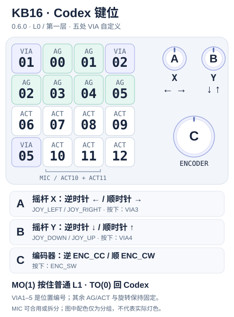

# Codex Micro ↔ KB16 位置对应图

> 测试版 0.5.0 已从 main 流水线刷入，版本和默认 L3 应答正确，未创建 Release，实体新功能仍待验收。原生 Codex 控制按 4×4 位置对应，编码器/摇杆功能交给 3 个旋钮。两个顶角方键、A/B 按下和左下角共五处交给 VIA；固定一秒退出移到左上方键，左下可持续按住。

## 当前固件矢量布局



- 可直接放大/编辑的项目资源：[中文 SVG](assets/kb16-codex-layout-zh.svg) · [English SVG](assets/kb16-codex-layout-en.svg)。两份内容一致，根目录双语 README 分别嵌入对应语言。
- 16 个方键按当前 L3 事件标注，VIA1–5 是可改位置编号、不是层号；右侧旋钮中心对应 VIA 定义的 A `(4.75, 0)`、B `(6, 0)`、C `(5.375, 2.5)`；外壳/旋钮大小仅为示意，不是 PCB 尺寸图或实机照片。
- 左上角短按松开发出 VIA1，长按 1 秒只回 L0；左下角 VIA5 直接执行第四页配置，可按住，不再强制退出。普通层配置 `TO(3)` 返回 L3。A/B 按下分别执行 VIA3/4，旋转仍是摇杆 X/Y，C 按下固定 `ENC_SW`。[配置、首次迁移及 OLED 提示](codex-via-keys.md)。
- ACT10/ACT11 是 MIC 的两个事件位置，可由宿主合用或拆开绑定；图中背景色只用于分组，不是灯光状态。当前任务灯颜色/亮度/效果以 [灯光说明](lighting.md) 为准。
- 数据来源：[当前 keymap](../firmware/keymaps/codex_micro_via_v1/keymap.c) / [VIA 定义](../firmware/via/kb16_codex_via.json)。后续调整物理映射时需同步两份 SVG 及 README 对照表。

## Codex Micro 4×4

```text
┌────────┬────────┬────────┬────────┐
│ ENC    │ AG00   │ AG01   │ JOY    │
├────────┼────────┼────────┼────────┤
│ AG02   │ AG03   │ AG04   │ AG05   │
├────────┼────────┼────────┼────────┤
│ ACT06  │ ACT07  │ ACT08  │ ACT09  │
├────────┼────────┼────────┼────────┤
│ Mic    │ ACT11  │ ACT12  │ empty  │
└────────┴────────┴────────┴────────┘
```

- `ENC`：左上编码器（CC / CW / Press）
- `JOY`：右上平面摇杆（↑ → ← ↓）
- `ACT11`：官方双宽 Mic 的第二个位置（ACT10_ACT11）；当前 KB16 在 R4C3 发独立 ACT11
- `empty`：官方 13 键布局里的空位
- 触摸传感器在**左下角**（4×4 键区外），用于切层；它不是 Mic 键

> 官方底排的 Mic 是双宽键帽，覆盖 ACT10 + ACT11 两个开关位置；上图拆成 `Mic | ACT11` 是为了和 KB16 的 1u 键位对应。  
> 左下角还有一个独立的触摸传感器（切层），它不在 4×4 键位里，也不是 Mic。

## KB16 位置对应

```text
┌────────┬────────┬────────┬────────┐
│ VIA1   │ AG00   │ AG01   │ VIA2   │
│ (长按) │        │        │        │
├────────┼────────┼────────┼────────┤
│ AG02   │ AG03   │ AG04   │ AG05   │
├────────┼────────┼────────┼────────┤
│ ACT06  │ ACT07  │ ACT08  │ ACT09  │
├────────┼────────┼────────┼────────┤
│ VIA5   │ ACT10  │ ACT11  │ ACT12  │
│        │ (Mic)  │ (split)│        │
└────────┴────────┴────────┴────────┘
```

- 左上键：短按 VIA1，长按一秒回 L0；原生编码器交给旋钮 C（下方大旋钮）。
- 右上键：VIA2；摇杆 X/Y 交给旋钮 A/B（两个顶部旋钮）。
- 第四行三个 ACT 右移一格，R4C1 作为直接 VIA5 键；固定退出位已从左下角移到左上角。
- L3 左上角 `R1C1`：短按松开执行 VIA1，**按住 1 秒进入 L0、不发送短按**。普通层使用 VIA 的 `TO(0)`–`TO(3)` 等层动作；`TO(3)` 返回 Codex，不在普通层强占这个按键。
- 仍只定义四层，L0–L2 普通 VIA；L3 仅五处读取第四页的配置，其余 13 个原生按键、三组旋转和 C 按下始终固定。
- 新默认旋钮 B 按压为 `L0→L1→L2→L3`；开发版 L3 用左上角长按退出。首次升级将新开放五处清空一次，其他键位/宏不重置；旧五层目标迁移见 [五处改键说明](codex-via-keys.md)。
- 上版 `0.4.9-qmk` 曾刷入且用户确认 Codex 入层 Logo 正常；0.5.0 沿用其入层约一秒后显示任务、无任务保留 Logo 的规则。L0–L2 空闲为 1/2/3，发键时显示实际 USB 输出，松开约 900 ms 恢复数字；0.5.0 在 L3 五处普通输出上也显示提示。USB 身份由上电 10 秒窗口决定，切层不切身份；一小时息屏/按键唤醒仍未做实机验证。
- 下排 `R4C2` 起依次为 ACT10、ACT11、ACT12，其中只有 ACT10/ACT11 是原 MIC 两半的位置，ACT12 是独立动作事件。
- 官方左下角触摸传感器在 4×4 之外；KB16 没有，开发版用 `R1C1` 长按代替，已发布 0.4.9 则在 `R4C1`。
- 实际参与 Codex 的键：AG00-AG05、ACT06-ACT09、ACT10、ACT11、ACT12，共 13 个（拆分模式）。

## 3 个旋钮

| KB16 旋钮 | 对应 Codex 控制 | 动作 |
|---|---|---|
| A（左上） | 摇杆 X | 顺时针 = 右 `JOY_RIGHT`，逆时针 = 左 `JOY_LEFT` |
| B（右上） | 摇杆 Y | 顺时针 = 上 `JOY_UP`，逆时针 = 下 `JOY_DOWN` |
| C（下方大旋钮） | 编码器 | CC / CW / Press → `ENC_CC` / `ENC_CW` / `ENC_SW` |

两个顶部小旋钮做摇杆 X/Y，下方大旋钮做 Codex 编码器。

## 原厂 VIA 配置的旋钮功能（历史实机记录）

以下是原厂普通四层配置的历史记录；当前四层版只把 L0–L2 作为普通层，L3 已固定 Codex。下表原厂循环不再代表新版运行行为：

| 旋钮 | 逆时针 | 顺时针 | 按下 |
|---|---|---|---|
| 旋钮 1（左上） | 亮度降低 `KC_BRID` | 亮度提高 `KC_BRIU` | 回到 Layer 0，`TO(0)` |
| 旋钮 2（右上） | 音量降低 `KC_VOLD` | 音量提高 `KC_VOLU` | 循环切层 `L0→L1→L2→L3→L0` |
| 旋钮 3（下方中间） | 上一首 `KC_MPRV` | 下一首 `KC_MNXT` | 播放/暂停 `KC_MPLY` |

- 三个旋转功能在其余层大多为 `KC_TRNS`，会继承 Layer 0，所以表现上全层一致。
- 旋钮 3 在 Layer 2 下，顺/逆时针都映射为鼠标左键 `KC_MS_BTN1`。
- 旋钮按下分别占用 4×5 矩阵第 0、1、2 行的第 5 列；第 3 行第 5 列为空。
- 当前 Codex Layer 3 的用途为下方编码器 + 顶部两个摇杆轴；普通层新版默认 B 按压最终进入 L3，不再回 L0。

## 关于 Mic

Mic 不是独立硬件，官方是双宽键 `ACT10 + ACT11`，可以合并，也可以拆分：

- **合并模式**：`ACT10_ACT11` 作为一个 Mic；KB16 可用一个键发 `ACT10`，另一个键空着或放别的功能。
- **拆分模式**：ChatGPT 的 `separateMicrophoneKeys` 打开；`ACT10`、`ACT11` 是两个独立槽，KB16 的 R4C2/R4C3 分别发 `ACT10`/`ACT11`，每个都可以在宿主绑定不同功能。
- 当前 keymap 已支持独立 ACT11；旧上游只发 ACT10 的行为仅作历史参考。
- Mic 可以与其他 ACT 互换；拆分后 `ACT10`/`ACT11` 也可以各自换位置。
- 官方宽键没有 KB16 双宽键帽，但两个 1u 键可以模拟它的两个半键。

## 位置映射表

| Codex Micro 位置 | Codex 控制 | KB16 位置 | KB16 控制 |
|---|---|---|---|
| R1C1 | ENC | 旋钮 C（下方大旋钮） | `ENC_CC/CW/SW` |
| R1C2 | AG00 | R1C2 | AG00 |
| R1C3 | AG01 | R1C3 | AG01 |
| R1C4 | JOY | 旋钮 A/B（顶部两个） | 摇杆 X/Y |
| R2C1 | AG02 | R2C1 | AG02 |
| R2C2 | AG03 | R2C2 | AG03 |
| R2C3 | AG04 | R2C3 | AG04 |
| R2C4 | AG05 | R2C4 | AG05 |
| R3C1 | ACT06 | R3C1 | ACT06 |
| R3C2 | ACT07 | R3C2 | ACT07 |
| R3C3 | ACT08 | R3C3 | ACT08 |
| R3C4 | ACT09 | R3C4 | ACT09 |
| 左下角触摸传感器 | 原厂切层 | R1C1（开发版） | L3 长按 1 秒进入 L0；短按 VIA1，普通层由 VIA 配置 |
| R4C1 | Mic（ACT10） | R4C2 | ACT10（Mic 主键） |
| R4C2 | ACT11 | R4C3 | ACT11（拆分模式） |
| R4C3 | ACT12 | R4C4 | ACT12 |
| R4C4 | empty | — | 不占用（第四行已右移） |

## 默认动作

| Codex 控制 | 默认动作 |
|---|---|
| AG00-AG05 | 6 个 Agent 键；默认跟随 Recent chats，可改 Pinned / Priority / Custom |
| 摇杆 ↑ | Toggle Plan Mode |
| 摇杆 → | Forward |
| 摇杆 ↓ | Toggle Sidebar |
| 摇杆 ← | Back |
| ACT06 | Fast mode |
| ACT07 | Approve |
| ACT08 | Reject |
| ACT09 | Split / Fork |
| ACT12 | Submit / Codex |
| Mic（ACT10） | Push-to-talk / Voice Chat（合并模式） |
| ACT11 | 拆分后由 ChatGPT keycap 设置决定；默认 EMPT1/空 |

## 关键差异

- **左上/右上**：官方是编码器/摇杆，不是按键；原生功能移到 3 个旋钮，KB16 方键可用 VIA1/2，左上保留一秒退出。
- **AG 灯**：6 个 AG 键在 R1C2、R1C3、R2C1-R2C4，任务灯跟着这 6 个位置。
- **底排右移**：KB16 的 ACT10/ACT11/ACT12 在 R4C2–R4C4，R4C1 是可持续按住的 VIA5，不再承担强制退出。
- **ACT11**：官方是双宽 Mic 的第二个半键；KB16 在 R4C3 发独立的 ACT11。
- **触摸传感器**：官方在机身边缘；KB16 开发版在 L3 用 R1C1 长按 1 秒离开 Codex，普通层通过 VIA `TO(3)` 返回。
- **旋钮数量**：官方 1 个；KB16 3 个：两个顶部小旋钮做摇杆 X/Y，下方大旋钮做编码器。
- **历史实机状态**：`0.3.0-qmk` 于 2026-10-30 验证过当时左下长按 5 秒退出、旋钮 B 返回和 OLED 编号。当前设备已更新到流水线测试版 0.5.0，五处自定义和左上退出未实机验收，不能沿用旧版结果。
