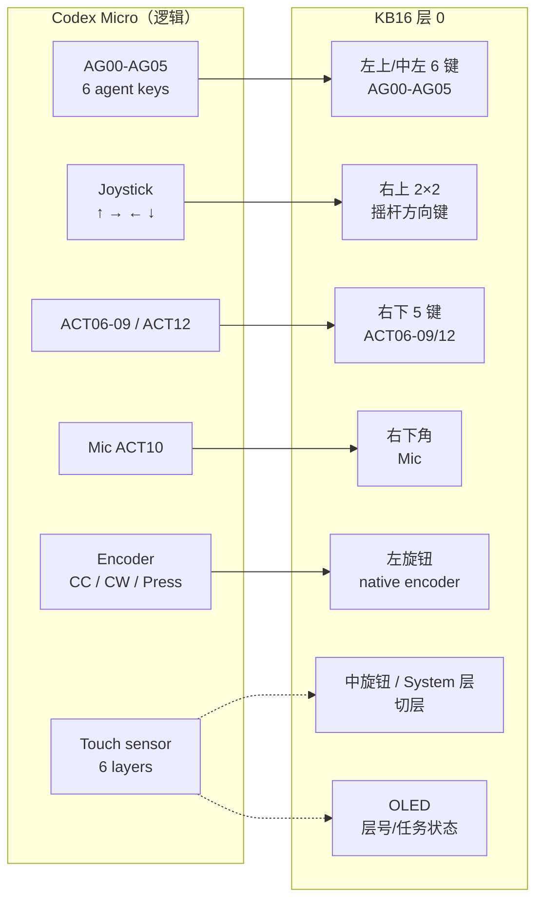

# Codex Micro ↔ KB16 键位对应图

> 说明：Codex Micro 部分按官方 13 键的逻辑分组（2 + 4 + 4 + 3）绘制，不是官方 PCB 丝印位置；KB16 部分是固件层 0 的默认 4×4 布局。

## Codex Micro（逻辑布局）

```text
              ┌──────────┐
              │ Encoder  │  CC / CW / Press
              └──────────┘

┌────────┬────────┬────────┬────────┐
│ AG00   │ AG01   │        │        │
├────────┼────────┼────────┼────────┤
│ AG02   │ AG03   │ AG04   │ AG05   │
├────────┼────────┼────────┼────────┤
│ ACT06  │ ACT07  │ ACT08  │ ACT09  │
├────────┼────────┼────────┼────────┤
│ Mic    │ ACT11  │ ACT12  │        │
└────────┴────────┴────────┴────────┘

┌──────────────┐
│ Touch sensor │  左下角：切层（最多 6 层）
└──────────────┘

┌──────────────┐
│   Joystick   │  模拟摇杆：↑ → ← ↓
└──────────────┘
```

## KB16 层 0（默认 Codex 布局）

```text
┌─────────┬─────────┬──────────────┬──────────────┐
│ AG00    │ AG01    │ 摇杆 ↑       │ 摇杆 →       │
├─────────┼─────────┼──────────────┼──────────────┤
│ AG02    │ AG03    │ 摇杆 ←       │ 摇杆 ↓       │
├─────────┼─────────┼──────────────┼──────────────┤
│ AG04    │ AG05    │ ACT06        │ ACT07        │
├─────────┼─────────┼──────────────┼──────────────┤
│ ACT08   │ ACT09   │ ACT12        │ Mic（ACT10） │
└─────────┴─────────┴──────────────┴──────────────┘

左旋钮 = Codex 原生编码器（ENC_CC / ENC_CW / ENC_SW）
中/右旋钮 = KB16 额外旋钮（默认滚轮/切层等）
OLED = 层号 / 任务状态
```

## 对应关系

| Codex Micro 控制 | KB16 层 0 位置 | 说明 |
|---|---|---|
| AG00 | R1C1 | 6 个 Agent 键之一 |
| AG01 | R1C2 | 6 个 Agent 键之一 |
| AG02 | R2C1 | 6 个 Agent 键之一 |
| AG03 | R2C2 | 6 个 Agent 键之一 |
| AG04 | R3C1 | 6 个 Agent 键之一 |
| AG05 | R3C2 | 6 个 Agent 键之一 |
| Joystick ↑ | R1C3 | 数字方向键，无模拟量 |
| Joystick → | R1C4 | 数字方向键，无模拟量 |
| Joystick ← | R2C3 | 数字方向键，无模拟量 |
| Joystick ↓ | R2C4 | 数字方向键，无模拟量 |
| ACT06 | R3C3 | 默认 Fast mode |
| ACT07 | R3C4 | 默认 Approve |
| ACT08 | R4C1 | 默认 Reject |
| ACT09 | R4C2 | 默认 Split / Fork |
| ACT12 | R4C3 | 默认 Submit / Codex |
| Mic（ACT10） | R4C4 | Push-to-talk / Voice Chat |
| ACT11 | 无 | KB16 没有独立键，固件不发送 |
| Encoder | 左旋钮 | CC / CW / Press，Codex 层锁定 |
| Touch sensor | 无直接对应 | KB16 用中旋钮/System 层切层 |
| 3 个层 LED | OLED | KB16 用屏幕显示层号 |
| 6 层 | 4 层 | Codex / Number / Navigation / System |

## 逻辑映射图



## 关键差异

- **摇杆**：官方是模拟摇杆，Codex 只取四方向；KB16 用四个数字键。
- **触摸传感器**：KB16 没有；用中旋钮按下/System 层动作替代切层。
- **层数**：官方最多 6 层；KB16 固定 4 层。
- **ACT11**：官方有独立键；KB16 没有，固件空槽，Mic 使用 ACT10。
- **编码器**：官方 1 个；KB16 3 个，只有左旋钮是 Codex 原生编码器。
- **屏幕**：官方没有；KB16 有 128×32 OLED。
